# Customer Revenue & Retention Analytics

An end-to-end retail analytics project using Python, Snowflake SQL, Tableau, and a locally hosted generative AI model to analyze revenue performance, customer behaviour, cohort retention, and product-category performance.

## Project Overview

This project analyzes **1,033,036 cleaned retail transactions** from a UK-based online retailer, covering December 2009 through December 2011.

The project combines:

* Python and Pandas for data preparation and exploratory analysis
* RFM analysis for customer segmentation
* Cohort analysis for measuring customer retention
* Ollama and Qwen3:4B for local product classification
* Snowflake for cloud data warehousing
* Tableau for interactive business dashboards

## Business Questions

The project addresses the following questions:

* How much gross and net merchandise revenue was generated?
* How much revenue was lost through cancellations?
* How did monthly revenue change over time?
* What proportion of customers made repeat purchases?
* Which customer segments contributed the most revenue?
* How did customer retention change after the first purchase?
* Which product categories generated the most net revenue?


## Recommendations (from this dataset)

The findings below are associations observed in this dataset, not proof of cause and effect. This is a portfolio analysis of a public dataset, so no business acted on these results.

**1. Weight retention effort toward the Champions segment.**
1,448 Champions are 24.74% of identified customers and account for 74.04% of identified-customer net revenue, so an average Champion is worth about three times an average identified customer (£8,346 vs £2,789 in net revenue). A retailer could test whether loyalty benefits and account outreach aimed at this segment hold more revenue than broad campaigns.

**2. Look at the second purchase, not only at acquisition.**
27.65% of identified customers never purchased again, and weighted retention falls to 23.04% by Month 2. Most of the drop happens immediately after the first order, so a follow-up in the first 30 days is worth testing against further top-of-funnel spend.

**3. Size the cancellations before trying to reduce them.**
£716,462.57 of cancellations is a 3.65% cancellation rate against gross merchandise sales, so one percentage point is roughly £196K of gross sales. The dataset carries no cancellation reason codes, so the causes cannot be identified from this data alone.

**Next steps this data supports:** capture cancellation reason codes at the point of order, and review the 12 product categories against an ABC classification to identify range-rationalisation candidates.

## Presentation

A 7-slide summary of the findings and recommendations, with speaker notes: [PowerPoint](presentation/Customer_Revenue_Retention_Summary.pptx) · [PDF](presentation/Customer_Revenue_Retention_Summary.pdf).

## Project Architecture

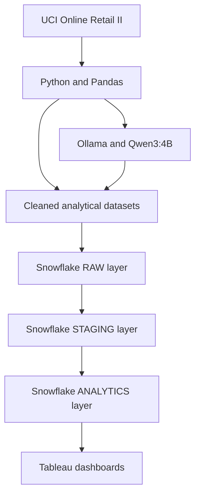

## Tools and Technologies

* Python
* Pandas and NumPy
* Matplotlib and Seaborn
* Jupyter Notebook
* Snowflake SQL
* PostgreSQL (dimensional model)
* Excel (Power Query, Data Model, PivotTables)
* Tableau
* Ollama
* Qwen3:4B
* Git and GitHub
* Visual Studio Code

## Key Business Results

| KPI                     |         Result |
| ----------------------- | -------------: |
| Gross merchandise sales | £19,604,891.64 |
| Estimated net revenue   | £18,888,429.07 |
| Cancellation value      |    £716,462.57 |
| Cancellation rate       |          3.65% |
| Sales invoices          |         39,515 |
| Units sold              |     11,188,001 |
| Known customers         |          5,852 |
| Average order value     |        £496.14 |

## Customer Insights

* Repeat customers represented **72.35%** of known customers.
* Repeat customers generated **96.74%** of identified-customer gross sales.
* One-time customers represented **27.65%** of known customers.
* The **Champions** segment contained **1,448 customers**.
* Champions represented **24.74%** of identified customers.
* Champions generated **74.04%** of identified-customer net revenue.

## Customer Retention

| Retention period | Weighted retention |
| ---------------- | -----------------: |
| Month 2          |             23.04% |
| Month 3          |             23.29% |
| Month 6          |             21.75% |
| Month 12         |             21.65% |

The cohort heatmap shows a substantial decline after the initial purchase. Retention then remains comparatively stable at approximately 20% across many mature cohorts.

Weighted retention was calculated using the total retained customers and total eligible customers across all eligible cohorts for each retention period.

### Retention drivers (notebook 07)

**Question:** Which early customer behaviours are linked to a customer still buying 6–12 months after their first purchase?

**Method**

* **Who is included:** 4,284 customers whose first purchase was at least 365 days before the end of the data.
* **Retained:** bought again between day 181 and day 365.
* **Early repeat:** bought again on a later day within 30 days of the first purchase.
* I compared retention rates using Wilson confidence intervals and chi-square tests. I then fitted a logistic regression so each driver is measured with the others held constant.

**Data start check:** The data begins in December 2009. Customers who first appear that month likely include older customers who had already bought before the data began. These 951 customers retained at 79%, against 50% for everyone else, so I excluded them. The results below use the remaining 3,333 customers, whose baseline retention is 49.7%.

| Driver | Retention | Odds ratio (95% CI) |
| ------ | --------- | ------------------- |
| Bought again within 30 days | 67.1% vs 46.4% | 2.23 (1.83–2.73) |
| First order value (per doubling) | 37.4% in lowest quartile → 58.8% in highest | about 1.21 |
| First purchase in Nov–Dec 2010 | 38.8% vs 51.1% | 0.57 (0.45–0.72) |
| UK customer | no clear difference | 1.01 (0.78–1.30) |

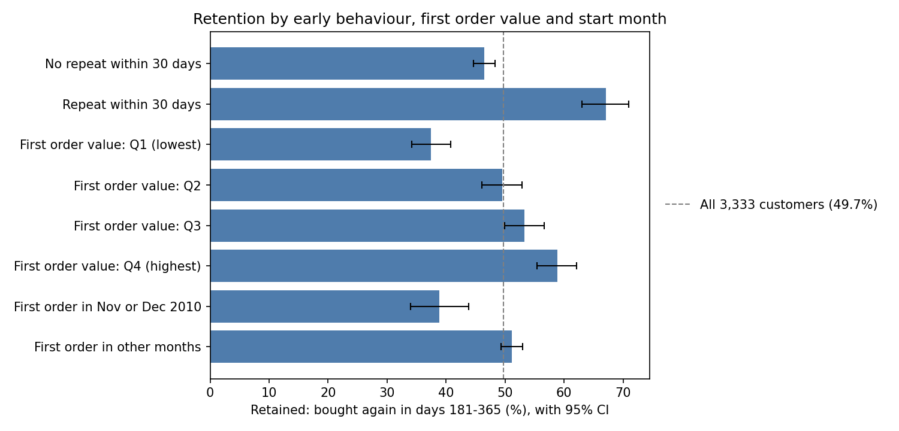

**Note:** On all 4,284 customers, holiday starters seemed to retain *better*. The result flipped once the December 2009 group was removed. That group was distorting the comparison, so the check mattered.

**Limits:** These are associations, not causes. The data comes from a single online retailer.

**Suggested next step:** A/B test a follow-up offer sent within 30 days of a first order. Track holiday first-time buyers as their own group.

## Generative AI Product Classification

Product descriptions were classified into business-friendly categories using the local **Qwen3:4B** model through Ollama.

The classification workflow included:

* Local LLM-based classification
* A controlled business-category taxonomy
* Keyword-rule validation
* Model and rule agreement checks
* High-confidence rule overrides
* Manual quality assurance
* Structural and completeness validation

The final classification output contains:

* **4,725 product records**
* **4,725 unique stock codes**
* **12 finalized product categories**
* **0 duplicate stock codes**
* **0 missing classification categories**

The category-performance mart also preserves a transparent `Unclassified` bucket for unmatched technical or non-sale stock codes that were outside the finalized product-classification input.

Because the model runs locally, the workflow does not require a paid API and does not send transaction data to an external AI service.

### GenAI Category Analysis

#### Net Revenue by Product Category

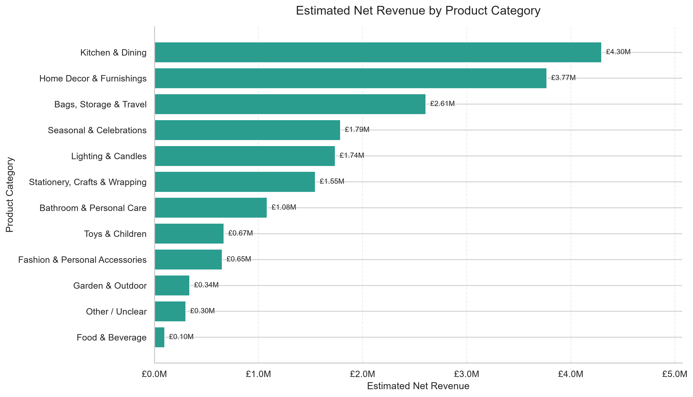

#### Product Share vs Revenue Share

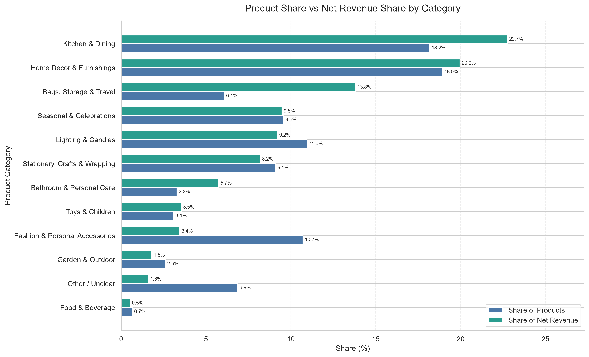

## Revenue Forecast and Budget vs Actual (Jun - Nov 2011)

**Question:** how well can monthly net revenue be forecast, and how did actual results compare with a plan?

**Test design**
- Train: Jan 2010 - May 2011 (17 months). Test: Jun - Nov 2011 (6 months), never used for fitting.
- One forecast made at the end of May 2011 for all six test months (fixed origin, 1 to 6 months ahead).
- December 2011 excluded: the data ends on 9 Dec 2011, so it is a partial month.

**Methods and results**

| Method | MAE | WAPE | Bias |
|---|---:|---:|---:|
| Seasonal naive (same month last year) | £54,143 | 5.84% | -5.58% |
| Seasonal naive x YoY growth (Jan-May 2011 vs 2010: -4.93%) | £94,907 | 10.24% | -10.24% |
| Holt linear trend (no seasonality) | £224,263 | 24.19% | -21.66% |

- The simplest method won. Seventeen months is too short to fit a 12-month seasonal model reliably, and Holt's trend model, with no seasonality, missed the autumn peak.
- Adjusting for the weak first half of 2011 made the forecast worse: revenue recovered from September (Sep 2011 was 20.2% above Sep 2010).

**Budget vs actual (illustrative)**

The budget is a hypothetical planning scenario, not a real company budget: 2010 actual for the same month plus 10% growth, set before the year starts. The revised forecast is the growth-adjusted forecast made at the end of May.

| Jun - Nov 2011 | Net revenue |
|---|---:|
| Budget | £5,778,140 |
| Revised forecast (May) | £4,993,703 |
| Actual | £5,563,143 |
| Variance vs budget | -£214,998 (-3.7%) |
| of which gross sales | -£241,919 |
| of which cancellations | +£26,922 |
| Variance vs revised forecast | +£569,440 |

- Actual revenue was below budget in 5 of 6 months; the largest shortfall was October 2011 (-£114,182).
- The shortfall came from lower gross sales; fewer cancellations than planned offset about £27K of it.
- The May revised forecast was too pessimistic by £569K: it extended the weak first half into an autumn that recovered.

**Files**
- `forecast/forecast_variance.py`: forecasts, error scores and budget vs actual, read from `data/processed/analytics/monthly_revenue.csv`; CSV outputs in `forecast/output/`.
- `forecast/build_workbook.py`: builds the Excel report from those outputs.
- `forecast/output/forecast_variance_report.xlsx`: variance, KPIs and error measures are live Excel formulas; the planning-growth cell on the first sheet can be changed to test other budget scenarios; a check cell confirms that the variance equals the gross sales effect plus the cancellation effect.

**Limitations:** one six-month test period; monthly data only, so no country-level split in this section; the budget is illustrative.

## Power Query in Excel: Loading and Deduplicating the Raw File

The Python cleaning notebook was rebuilt in Excel Power Query as an independent check, and the result was loaded into the Excel Data Model.

**Steps (`excel/retail_power_query.xlsx`)**
- Source: `data/raw/online_retail_II.xlsx`, two sheets (`Year 2009-2010`, `Year 2010-2011`), one query each with explicit column types.
- `retail_combined`: the two sheets appended into one table.
- `retail_clean`: a reference to `retail_combined` with duplicate rows removed across all 8 columns.
- `row_counts`: an M query that counts the rows in both tables with `Table.RowCount` and compares them with the figures from `notebooks/02_data_cleaning.ipynb`, returning OK or MISMATCH.
- `retail_clean` is loaded to the Data Model only, because 1,033,036 rows is too close to the worksheet limit of 1,048,576. The other queries are connection only.

**Result**

| Check | Python notebook | Power Query | Status |
|---|---:|---:|---|
| Rows after stacking both sheets | 1,067,371 | 1,067,371 | OK |
| Rows after removing duplicates | 1,033,036 | 1,033,036 | OK |
| Duplicates removed | 34,335 | 34,335 | OK |

A PivotTable on the `pivot_by_country` sheet counts line items by country directly from the Data Model; its grand total is 1,033,036.

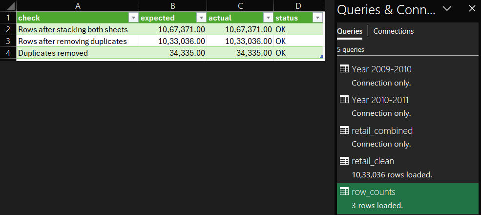

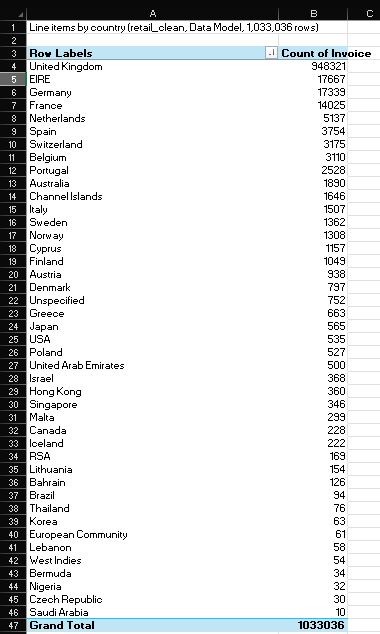

**To refresh:** place the raw file at `data/raw/online_retail_II.xlsx`, open the workbook, update the file path in Data > Get Data > Data Source Settings if your folder is different, then Data > Refresh All.

**Scope:** this step covers stacking and duplicate removal only. Cancellations, returns and missing customer IDs are handled in the Python notebooks.

## Tableau Dashboards

The dashboards are published on Tableau Public and can be explored in the browser: [Revenue Overview](https://public.tableau.com/app/profile/aditya.ranjan7019/viz/Customer_Revenue_Retention_Analytics_Snowflake/RevenueOverview) · [Retention Overview](https://public.tableau.com/app/profile/aditya.ranjan7019/viz/Customer_Revenue_Retention_Analytics_Snowflake/RetentionOverview) · [Segment LOD Analysis & Reconciliation (FIXED, INCLUDE, EXCLUDE + Blend)](https://public.tableau.com/app/profile/aditya.ranjan7019/viz/Customer_Revenue_Retention_Analytics_Snowflake_17926845101980/LODAnalysis).

### Revenue Overview

The Revenue Overview dashboard presents:

* Gross merchandise sales
* Estimated net revenue
* Sales invoice count
* Known customer count
* Cancellation rate
* Complete-month estimated net revenue trend
* Estimated net revenue by product category

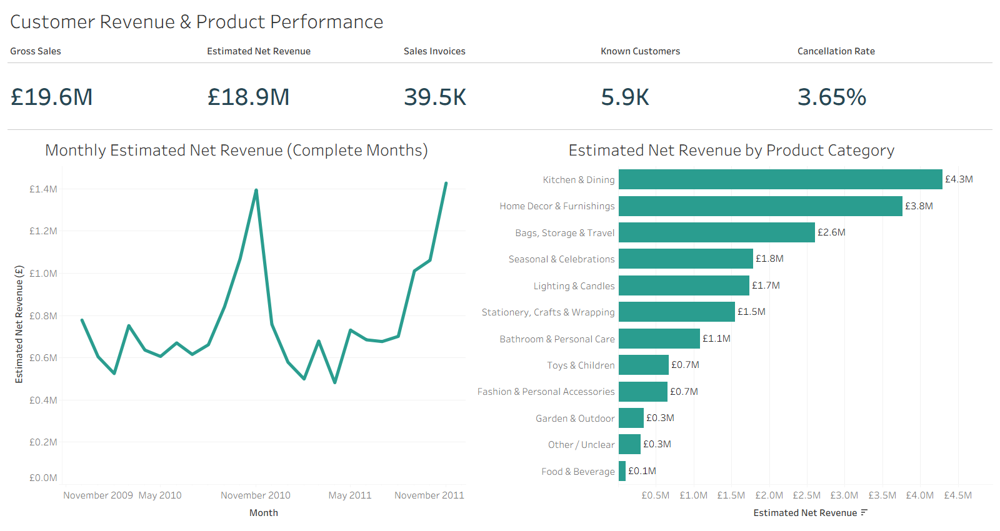

### Retention Overview

The Retention Overview dashboard presents:

* Weighted retention KPIs for Months 2, 3, 6, and 12
* Net-revenue contribution by customer segment
* Customer cohort retention heatmap
* Retention percentage colour scale

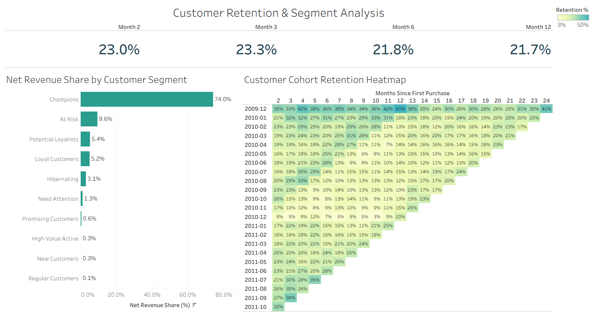

### Customer Segments: FIXED, INCLUDE & EXCLUDE LOD + Data Blend

This dashboard was added after the first two and is published as a separate view: [Customer Segment Revenue Share (FIXED LOD)](https://public.tableau.com/app/profile/aditya.ranjan7019/viz/Customer_Revenue_Retention_Analytics_Snowflake_17926845101980/LODAnalysis).

It uses all three types of level-of-detail expression on the RFM customer table (5,852 customers), plus a data blend:

| Calculation | Formula |
| --- | --- |
| Segment Revenue (LOD) | `{ FIXED [customer_segment] : SUM([net_monetary_value]) }` |
| Segment Revenue Share (LOD) | `[Segment Revenue (LOD)] / { FIXED : SUM([net_monetary_value]) }` |
| Country Avg Revenue (LOD) | `{ FIXED [primary_country] : AVG([net_monetary_value]) }` |
| Vs Country Average | `IF [net_monetary_value] > [Country Avg Revenue (LOD)] THEN "Above country average" ELSE "At or below country average" END` |
| Country Revenue (INCLUDE) | `{ INCLUDE [primary_country] : SUM([net_monetary_value]) }`, shown as AVG at segment level |
| Country Group | `IF [primary_country] = "United Kingdom" THEN "UK" ELSE "Outside UK" END` |
| Share of Segment Revenue (EXCLUDE) | `SUM([net_monetary_value]) / MIN({ EXCLUDE [Country Group] : SUM([net_monetary_value]) })` |

* **Segment share:** because the numerator and denominator are fixed, each segment's share of net revenue stays correct whatever else is on the view. Champions account for 74.04% of net revenue, matching the RFM analysis in notebook 04.
* **Country benchmark:** each customer is compared with the average for their own primary country rather than the global average. 994 of the 1,448 Champions are above their country's average and 454 are at or below it.
* **Average revenue per country (INCLUDE):** the view is at segment level and INCLUDE adds country underneath, so each segment shows its average net revenue per country it sells in. Champions sell in 22 countries at £549,312 per country on average, a figure pulled up by the UK.
* **UK share of segment revenue (EXCLUDE):** the view is segment × Country Group (UK / Outside UK) and EXCLUDE removes Country Group to get each segment's total. Nine segments take 79–93% of their revenue from the UK; High-Value Active takes only 45.70%, so most of that segment's revenue comes from outside the UK. Countries are grouped rather than filtered because EXCLUDE respects dimension filters: a UK-only filter would make every share 100%.
* **Reconciliation (data blend):** the RFM customer table (primary source) is blended with the Snowflake `MART_CUSTOMER_SEGMENTS` export (secondary source) on Customer Segment, and `Difference (LOD vs Snowflake)` = `SUM([Segment Revenue Share (LOD)]) - SUM([customer_segments].[Net Revenue Share Pct])`. Every segment differs by 0.05 percentage points or less, which is the rounding in the Snowflake export (3 decimals), so the Tableau and Snowflake segment shares agree.

| Segment | LOD share (Python RFM table) | Snowflake mart share | Difference |
| --- | ---: | ---: | ---: |
| Champions | 74.04% | 74.00% | 0.04% |
| At Risk | 9.60% | 9.60% | 0.00% |
| Potential Loyalists | 5.43% | 5.40% | 0.03% |
| Loyal Customers | 5.24% | 5.20% | 0.04% |
| Hibernating | 3.14% | 3.10% | 0.04% |
| Need Attention | 1.30% | 1.30% | 0.00% |
| Promising Customers | 0.58% | 0.60% | -0.02% |
| High-Value Active | 0.29% | 0.30% | -0.01% |
| New Customers | 0.25% | 0.30% | -0.05% |
| Regular Customers | 0.14% | 0.10% | 0.04% |

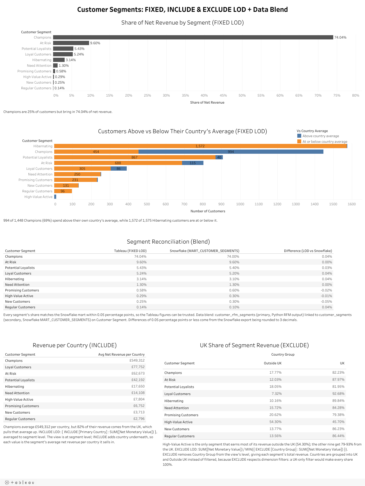

**Tableau Cloud deployment (practice):** the same workbook was also published to a personal Tableau Cloud developer site, into a project with an Analysts group (publish) and a Viewers group (view only). Project permissions are locked, viewers are denied summary-data downloads (their Viewer site role already blocks full data and workbook downloads), and the restrictions were checked by signing in as the viewer: only image, PDF and PowerPoint downloads were offered and there was no Edit option. The developer site is a private sandbox, so there is no public link.

The Tableau workbook is available here:

[Download the Tableau workbook](tableau/Customer_Revenue_Retention_Analytics_Snowflake.twbx)

## Project Workflow

1. Inspect and combine the original transaction worksheets.
2. Standardize column names and data types.
3. Remove duplicates and identify invalid records.
4. Separate merchandise sales, cancellations, and non-merchandise records.
5. Calculate gross sales, cancellation value, and estimated net revenue.
6. Create customer-level and RFM segment analysis.
7. Build monthly cohort-retention matrices.
8. Classify product descriptions with a local generative AI model.
9. Load the cleaned analytical outputs into Snowflake.
10. Build RAW, STAGING, and ANALYTICS warehouse layers.
11. Validate warehouse totals and business KPIs.
12. Connect Tableau to the Snowflake presentation views.
13. Build and validate the final dashboards.

## Repository Structure

```text
Customer-Revenue-Retention-Analytics/
│
├── data/
│   ├── README.md
│   └── processed/
│       ├── analytics/
│       └── cleaning_validation_summary.csv
│
├── dimensional_model/
│   ├── load_staging.py
│   ├── 01_dimensions.sql
│   ├── 02_dim_customer_scd2.sql
│   ├── 03_fact_sales.sql
│   ├── 04_validation.sql
│   └── 05_example_queries.sql
│
├── documentation/
│   ├── Data_Dictionary.md
│   └── Methodology.md
│
├── excel/
│   └── retail_power_query.xlsx
│
├── forecast/
│   ├── forecast_variance.py
│   ├── build_workbook.py
│   └── output/
│
├── presentation/
│   ├── Customer_Revenue_Retention_Summary.pptx
│   └── Customer_Revenue_Retention_Summary.pdf
│
├── notebooks/
│   ├── 01_data_inspection.ipynb
│   ├── 02_data_cleaning.ipynb
│   ├── 03_revenue_analysis.ipynb
│   ├── 04_customer_segmentation.ipynb
│   ├── 05_retention_cohort_analysis.ipynb
│   ├── 06_genai_product_classification.ipynb
│   └── 07_retention_drivers.ipynb
│
├── screenshots/
│   ├── tableau_revenue_overview.png
│   ├── tableau_retention_overview.png
│   ├── tableau_lod_analysis.png
│   ├── genai_category_net_revenue.png
│   ├── genai_product_vs_revenue_share.png
│   ├── retention_drivers.png
│   ├── power_query_row_counts.png
│   ├── power_query_pivot_by_country.png
│   └── dimensional_model_validation.png
│
├── sql/
│   ├── 01_environment_setup.sql
│   ├── 02_raw_table_setup.sql
│   ├── 03_raw_data_validation.sql
│   ├── 04_staging_model.sql
│   ├── 05_revenue_marts.sql
│   ├── 06_customer_marts.sql
│   ├── 07_retention_marts.sql
│   ├── 08_customer_segment_mart.sql
│   ├── 09_product_category_mart.sql
│   ├── 10_final_snowflake_validation.sql
│   └── 11_tableau_presentation_views.sql
│
├── tableau/
│   ├── Customer_Revenue_Retention_Analytics_Snowflake.twbx
│   └── README.md
│
├── .gitignore
├── README.md
└── requirements.txt
```

## Snowflake Data Model

The Snowflake implementation uses three layers:

* **RAW:** Stores the cleaned transaction-level data loaded into Snowflake.
* **STAGING:** Standardizes dates, business flags, transaction types, and revenue measures.
* **ANALYTICS:** Contains customer, revenue, retention, segmentation, product-category, and Tableau presentation views.

The final warehouse validation confirmed:

* RAW and STAGING row counts match at **1,033,036**
* All **10 required core analytical views** exist
* Revenue totals reconcile across warehouse layers
* RFM customer totals reconcile to **5,852 customers**
* Product classification records contain no duplicate stock codes
* Product-category revenue shares total **100%**

## Dimensional Model (Star Schema) in PostgreSQL

**Question:** can the cleaned data be modelled as a star schema that reproduces every total from the notebooks, and keeps customer history correct over time?

The Snowflake warehouse above is organised in layers but not as a dimensional model, and the Snowflake trial account has since ended. The star schema was therefore built in a local PostgreSQL database (`retail_dw`) from the same cleaned file.

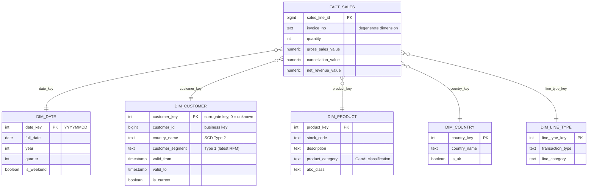

**Design**
- **Grain:** one row per invoice line, the same 1,033,036 rows as the cleaned data. The invoice number stays on the fact as a degenerate dimension.
- **Surrogate keys** on every dimension; the fact table stores only keys and measures.
- **`dim_customer` is SCD Type 2 on country.** 13 customers placed invoices from more than one country over time (31 changes). Each change starts a new version with `valid_from`, `valid_to` and `is_current`, and each sale is joined to the version that was true on its invoice date. Customer 12455, for example, now buys from Spain, but £5,067 of their net revenue came from earlier invoices in Cyprus; a Type 1 dimension would have moved it all to Spain. The changes in this dataset alternate between countries, so they look more like orders shipped to different places than customers moving; the method is the same either way.
- **`customer_segment`** (RFM) is a Type 1 attribute: the latest value on every version. Invoices with no customer ID (235,151 lines) point to an unknown member, `customer_key = 0`, instead of being dropped.
- **`dim_product`** keeps the most frequent description for stock codes that appear with several (1,188 of 5,131) and adds the GenAI product category.
- **`dim_line_type`** is a small junk dimension for the transaction type and line category flags.

**Validation:** 12 checks, all OK. Row count, gross sales, cancellations and net revenue match the notebook to the penny; net revenue matches in all 25 months; every line found its customer version; each customer has exactly one current row with no gaps or overlaps between versions.

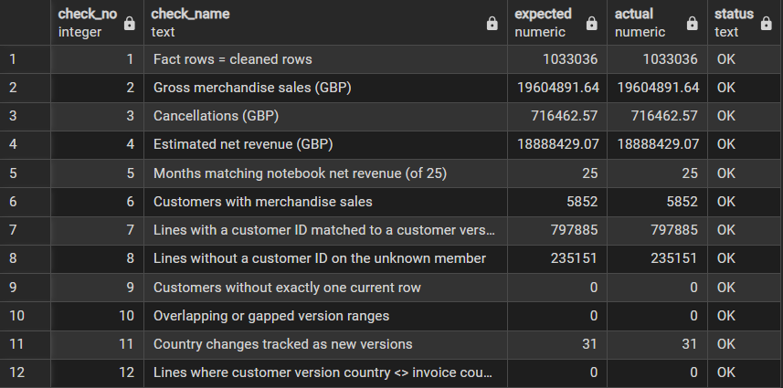

**Files (`dimensional_model/`)**
- `load_staging.py`: creates the `retail_dw` database and loads the cleaned data, product classifications, RFM segments and the notebook's monthly totals into `staging`.
- `01_dimensions.sql`, `02_dim_customer_scd2.sql`, `03_fact_sales.sql`: build the star schema.
- `04_validation.sql`: the 12 checks above.
- `05_example_queries.sql`: revenue by category and year, weekday vs weekend, the SCD Type 2 example, and RFM segment by country.

## Dataset

This project uses the **Online Retail II** dataset from the UCI Machine Learning Repository.

The original dataset contains **1,067,371 transaction records** from a UK-based online retailer.

The original Excel file is not included in this repository because of its size. It can be downloaded from:

[UCI Online Retail II Dataset](https://archive.ics.uci.edu/dataset/502/online%2Bretail%2Bii)

Place the downloaded file at:

```text
data/raw/online_retail_II.xlsx
```

## Running the Project

### 1. Clone the repository

```bash
git clone https://github.com/beingbrute/Customer-Revenue-Retention-Analytics.git
cd Customer-Revenue-Retention-Analytics
```


### 2. Install the Python packages

```bash
pip install -r requirements.txt
```

### 3. Install the local AI model

Install Ollama and download Qwen3:4B:

```bash
ollama pull qwen3:4b
```

### 4. Run the Python notebooks

Run the notebooks sequentially from `01` through `07`.

### 5. Build the Snowflake warehouse

Run the numbered SQL files in the `sql` folder in sequence.

After running the raw-table setup, load the cleaned transaction output and the generated customer-segment and product-classification outputs into their corresponding Snowflake tables.

### 6. Build the star schema in PostgreSQL

Needs a local PostgreSQL server (tested on 17) and the cleaned file from notebook `02`.

```bash
python dimensional_model/load_staging.py --port 5432
```

Then run `dimensional_model/01_dimensions.sql` to `05_example_queries.sql` in order against the `retail_dw` database (pgAdmin or psql). The password is typed when asked and never stored.

### 7. Open the Tableau workbook

Open:

```text
tableau/Customer_Revenue_Retention_Analytics_Snowflake.twbx
```

No sign-in is needed: the workbook packages CSV extracts of the Snowflake presentation views and of the RFM customer table used by the LOD dashboard. The same dashboards are on Tableau Public (see [Tableau Dashboards](#tableau-dashboards)).

## Documentation

Additional documentation is available in:

* [Methodology](documentation/Methodology.md)
* [Data Dictionary](documentation/Data_Dictionary.md)
* [Tableau Documentation](tableau/README.md)

## Author

**Aditya Ranjan**

Data Analyst | Python · SQL · Power BI · Tableau

[LinkedIn](https://www.linkedin.com/in/aditya-ranjan-data) · [GitHub](https://github.com/beingbrute) · adityaranjan17302215@gmail.com
