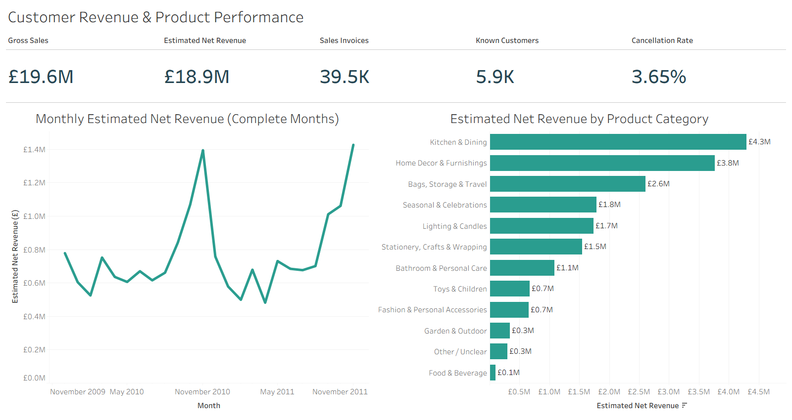
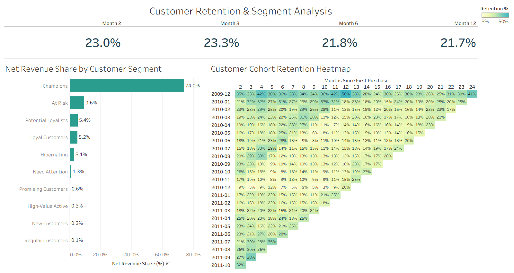
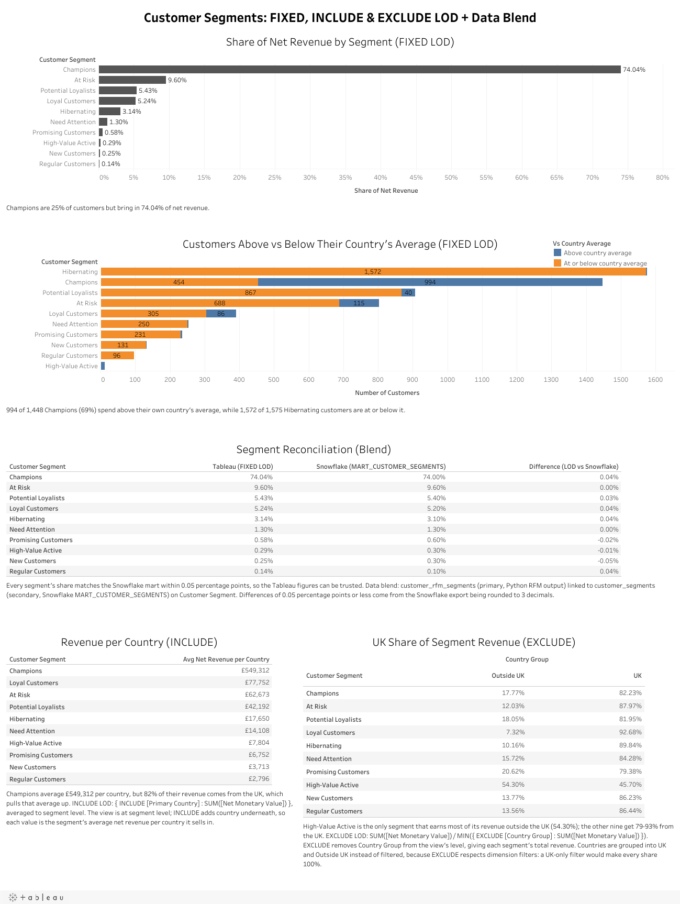

# Tableau Dashboards

This folder contains the packaged Tableau workbook for the Customer Revenue & Retention Analytics project.

The dashboards are also published on Tableau Public: [Revenue Overview](https://public.tableau.com/app/profile/aditya.ranjan7019/viz/Customer_Revenue_Retention_Analytics_Snowflake/RevenueOverview) · [Retention Overview](https://public.tableau.com/app/profile/aditya.ranjan7019/viz/Customer_Revenue_Retention_Analytics_Snowflake/RetentionOverview) · [Segment Revenue Share (FIXED LOD)](https://public.tableau.com/app/profile/aditya.ranjan7019/viz/Customer_Revenue_Retention_Analytics_Snowflake_17926845101980/LODAnalysis).

## Workbook

[Download the Tableau workbook](Customer_Revenue_Retention_Analytics_Snowflake.twbx)

```text
Customer_Revenue_Retention_Analytics_Snowflake.twbx
```

## How the Data Reaches Tableau

The dashboards were built against analytical views in the Snowflake `ANALYTICS` layer:

| Setting   | Value                           |
| --------- | ------------------------------- |
| Warehouse | `RETAIL_ANALYTICS_WH`           |
| Database  | `CUSTOMER_REVENUE_RETENTION_DB` |
| Schema    | `ANALYTICS`                     |

Tableau Public does not accept Snowflake connections, so each view was exported to CSV and packaged into the workbook as an extract. The workbook therefore opens without a Snowflake account, and its dashboard figures match the validated Snowflake results below. Percentages in the exported files are rounded to the precision the dashboards display.

## Tableau Data Sources

| Tableau data source    | Exported from Snowflake view |
| ---------------------- | ---------------------------- |
| `monthly_revenue`      | `MART_MONTHLY_REVENUE`       |
| `category_performance` | `MART_CATEGORY_PERFORMANCE`  |
| `customer_segments`    | `MART_CUSTOMER_SEGMENTS`     |
| `cohort_retention`     | `MART_COHORT_RETENTION`      |
| `revenue_kpi_cards`    | `MART_REVENUE_KPI_CARDS`     |
| `retention_kpi_cards`  | `MART_RETENTION_KPI_CARDS`   |
| `customer_rfm_segments` | `CUSTOMER_RFM_SEGMENTS`     |

`customer_rfm_segments` is the RFM output of `notebooks/04_customer_segmentation.ipynb` (`data/processed/analytics/customer_rfm_segments.csv`, 5,852 customers), the same table loaded into Snowflake as `ANALYTICS.CUSTOMER_RFM_SEGMENTS`. It feeds only the LOD dashboard.

## Dashboards

### Revenue Overview

The Revenue Overview dashboard presents the project’s primary commercial performance indicators.

It includes:

* Gross merchandise sales
* Estimated net revenue
* Sales invoice count
* Known customer count
* Cancellation rate
* Complete-month estimated net revenue trend
* Estimated net revenue by product category

The monthly trend excludes the final partial month to prevent an incomplete reporting period from being compared directly with complete months.



### Retention Overview

The Retention Overview dashboard presents customer-segment performance and post-acquisition retention.

It includes:

* Month 2 weighted retention
* Month 3 weighted retention
* Month 6 weighted retention
* Month 12 weighted retention
* Net-revenue share by customer segment
* Customer cohort-retention heatmap
* Retention-percentage colour legend

The cohort heatmap includes only periods each cohort was old enough to reach.



### Segment Revenue Share & Country Benchmark (FIXED LOD)

Added after the first two dashboards and published as a separate view: [Customer Segment Revenue Share (FIXED LOD)](https://public.tableau.com/app/profile/aditya.ranjan7019/viz/Customer_Revenue_Retention_Analytics_Snowflake_17926845101980/LODAnalysis).

It contains two sheets built on `customer_rfm_segments`:

* **Segment Share (LOD):** each customer segment's share of total net revenue.
* **Vs Country Average (LOD):** the number of customers in each segment whose net revenue is above or at/below the average for their own primary country.

| Calculation | Formula |
| --- | --- |
| Segment Revenue (LOD) | `{ FIXED [customer_segment] : SUM([net_monetary_value]) }` |
| Segment Revenue Share (LOD) | `[Segment Revenue (LOD)] / { FIXED : SUM([net_monetary_value]) }` |
| Country Avg Revenue (LOD) | `{ FIXED [primary_country] : AVG([net_monetary_value]) }` |
| Vs Country Average | `IF [net_monetary_value] > [Country Avg Revenue (LOD)] THEN "Above country average" ELSE "At or below country average" END` |

Results: Champions hold 74.04% of net revenue (matching the RFM analysis in notebook 04), and 994 of the 1,448 Champions are above their country's average.



## Validated Dashboard KPIs

### Revenue KPIs

| KPI                     |         Result |
| ----------------------- | -------------: |
| Gross merchandise sales | £19,604,891.64 |
| Estimated net revenue   | £18,888,429.07 |
| Sales invoices          |         39,515 |
| Known customers         |          5,852 |
| Cancellation rate       |          3.65% |

### Retention KPIs

| Retention period | Weighted retention |
| ---------------- | -----------------: |
| Month 2          |             23.04% |
| Month 3          |             23.29% |
| Month 6          |             21.75% |
| Month 12         |             21.65% |

## Opening the Workbook

1. Install Tableau Desktop or Tableau Public.
2. Download the packaged workbook from this folder.
3. Open `Customer_Revenue_Retention_Analytics_Snowflake.twbx`. No sign-in is needed, because the data is packaged inside the workbook.

## Tools

* Tableau Desktop
* Tableau Public
* Snowflake
* Snowflake SQL
* Python and Pandas
* Ollama and Qwen3:4B
